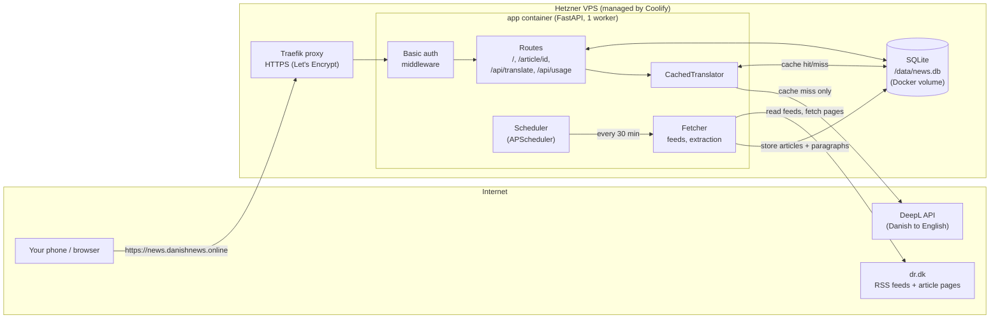
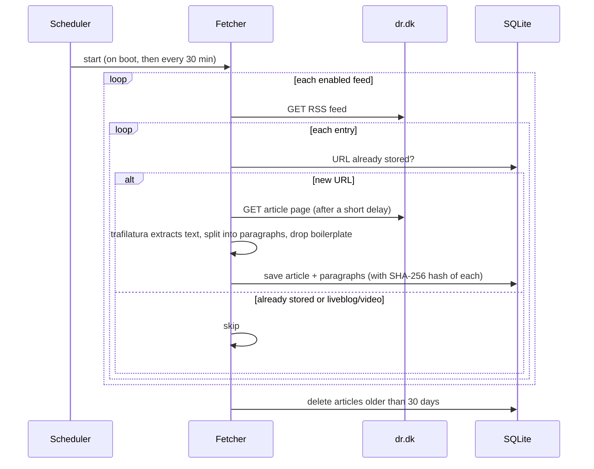
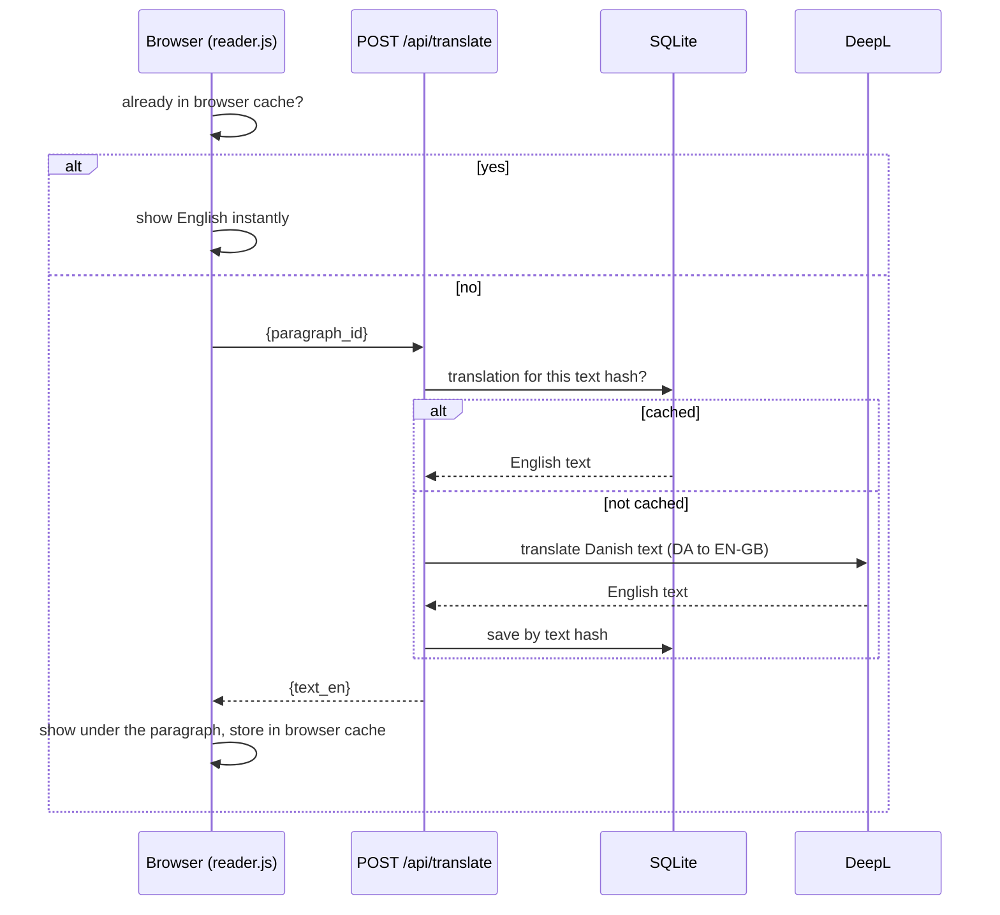
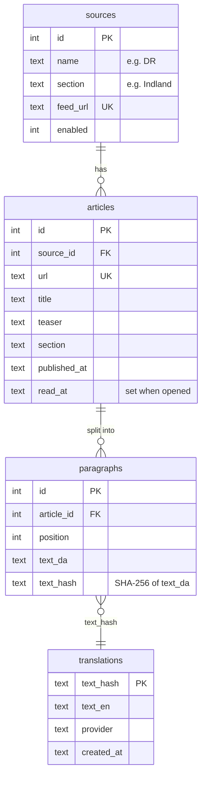

# How Danish News Reader works

A private web app that collects Danish news (DR), shows it in a clean reading view, and translates any paragraph to English when you tap it.

## The big picture



## The two main flows

### 1. Collecting articles (runs on its own, no translation)



### 2. Tapping a paragraph to translate it



## Pages and API

| Route | What it does |
|---|---|
| `GET /` | Feed page: newest first, filter by source/section, read articles dimmed |
| `GET /article/{id}` | Reading view; marks the article as read |
| `POST /api/translate` | Body `{"paragraph_id": n}` or `{"article_id": n, "field": "title"}`; returns `{"text_en": "..."}` |
| `GET /api/usage` | Remaining DeepL characters (cached 60 s), shown in the page header |
| `GET /healthz` | Health check (the only path that skips the password) |
| `GET /robots.txt` | Disallows everything; every response also has `X-Robots-Tag: noindex` |

## Files

```
app/
  main.py        FastAPI app, routes, rate limit on /api/translate, middleware
  auth.py        HTTP basic auth (scrypt hash); also a CLI to generate the hash
  config.py      Settings from environment variables + default DR feeds
  db.py          SQLite schema and all queries
  fetcher.py     RSS reading, article extraction, paragraph cleaning
  translate.py   Translator interface, DeepL implementation, cache layer
  scheduler.py   Runs the fetcher on an interval inside the app
  templates/     base.html, feed.html, article.html (Jinja2, server-rendered)
  static/        style.css, reader.js (click-to-translate), usage.js (quota counter)
tests/
  fixtures/      Saved DR article HTML used by the extraction tests
Dockerfile, docker-compose.yml   Container setup for Coolify
```

## Data model



Translations are keyed by the **hash of the Danish text**, not the paragraph id. An identical sentence in two articles is translated (and billed) only once.

## Design decisions worth knowing

- **Translate on demand.** Nothing is translated at fetch time, so DeepL characters are only spent on paragraphs you actually tap.
- **Swappable translator.** `translate(text, context)` sits behind a small interface in `translate.py`. To use Claude or another API, add a class with the same method and pass it to `CachedTranslator`. The cache layer doesn't change.
- **One process, one database file.** The scheduler runs inside the app, so there is no separate worker or cron container. This is also why the container runs a single uvicorn worker: more workers would each start their own scheduler.
- **Password in the app.** Coolify's Traefik handles HTTPS, and the app does basic auth itself (`BASIC_AUTH_USER` and `BASIC_AUTH_HASH`). If those aren't set the site is open, which is fine for local development only.
- **Polite scraping.** A custom User-Agent, a delay between requests, timeouts, and failures are logged and skipped instead of crashing the job.
- **Paywalls are never bypassed.**

## Configuration (environment variables)

| Variable | Purpose | Default |
|---|---|---|
| `DEEPL_API_KEY` | DeepL key (required to translate) | none |
| `DEEPL_TARGET` | `EN-GB` or `EN-US` | `EN-GB` |
| `BASIC_AUTH_USER` / `BASIC_AUTH_HASH` | Login; make the hash with `uv run python -m app.auth 'password'` | none (open) |
| `FETCH_INTERVAL_MINUTES` | How often to fetch feeds | 30 |
| `RETENTION_DAYS` | Delete articles older than this | 30 |
| `DB_PATH` | SQLite file location | `data/news.db` (`/data/news.db` in Docker) |

See the [README](README.md) for running locally and deploying.
